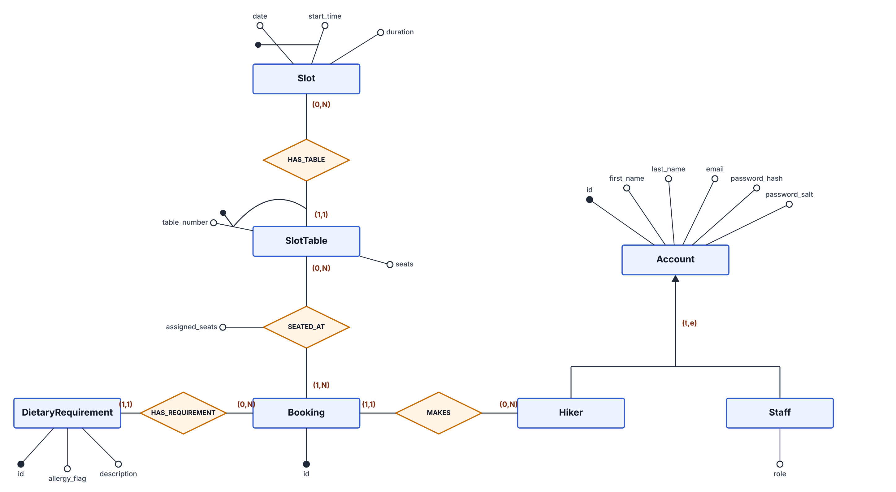

# Database

SQLite, accessed with `better-sqlite3`. The DB file path comes from the `DB_PATH` environment variable (default `backend/src/data/database.sqlite`).

## Conceptual schema

## Logical schema

Primary keys in **bold**, `*` = nullable.

- account(**id**, first_name, last_name, email, password_salt, password_hash, role)
- slot(**date**, **start_time**, duration)
- slot_table(**(slot_date, slot_start_time)** → slot, **table_number**, seats)
- booking(**id**, hiker_id → account)
- seated_at(**booking_id** → booking, **(slot_date, slot_start_time, table_number)** → slot_table, assigned_seats)
- dietary_requirement(**id**, booking_id → booking, allergy_flag, description)

## Rules not visible in the diagrams

- `account.email` is unique.
- `account.role` ∈ {`hiker`, `employee`, `warden`}; a warden can also perform employee functions.
- `slot.duration` is expressed in minutes.
- All `seated_at` rows of the same booking refer to the same slot.
- For each `slot_table`: SUM(`assigned_seats`) ≤ `seats`.
- `assigned_seats` ≥ 1.
- Party size of a booking = SUM(`assigned_seats`).

## SQL scripts (`backend/src/database/sql/`)

| File | Content |
|---|---|
| `drop-core.sql` | Drops all tables |
| `init-core.sql` | Creates `account`, `slot`, `slot_table`, `booking`, `seated_at`, `dietary_requirement` |
| `seed-core.sql` | 4 demo accounts (warden, employee, 2 hikers), 4 slots with the same table layout, 3 demo bookings with seats and dietary requirements |
| `clear-core.sql` | Empties all tables |

`RESET_DB=true` runs drop, init and seed at startup.
