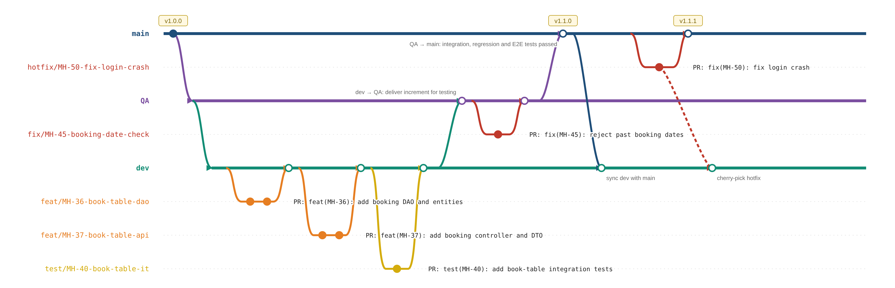

# Working agreement

## Branches
We use three long-lived branches, all protected: no direct pushes, every change goes through a PR.

| Branch | Purpose |
|---|---|
| `dev` | Integration of completed tasks  |
| `qa` | Quality control of the increment before release |
| `main` | Stable version shown at the demo and released |

### Flow
1. **Develop**: create the task branch from `dev`, open a PR into `dev`.
2. **Deliver to QA**: when all the stories selected for the demo are merged, open a PR `dev` → `QA`.
3. **Test on QA**: run integration, regression and E2E tests, check the acceptance criteria and run the Docker image on more than one PC. Fix bugs with a `fix/` branch from `QA`, merged back into `QA`.
4. **Release**: open a PR `QA` → `main` and tag the release (e.g. `v1.0.0`).
5. **Sync**: open a PR `main` → `dev`.

Urgent bugs on `main` are fixed with a `hotfix/` branch from `main`, then cherry-picked into `dev` if needed.
Merged branches are deleted.

Each task branch corresponds to one YouTrack task and is named `<type>/MH-<id>-<short-description>`:
  - `<type>`: same types as Conventional Commits (see below)
  - `MH-<id>`: the ID of the YouTrack task, so the branch can be traced back to it
  - `<short-description>`: a few words, lowercase, kebab-case, no personal names

Examples:

    docs/MH-32-book-table-api-spec
    feat/MH-36-book-table-dao-entities
    feat/MH-37-book-table-controller-dto
    feat/MH-38-book-table-api-route
    feat/MH-31-book-table-ui
    test/MH-40-book-table-integration-tests

## Commits
We follow [Conventional Commits](https://www.conventionalcommits.org/en/v1.0.0/).

    <type>(<scope>): <description>

- Types: `feat`, `fix`, `docs`, `test`, `refactor`, `build`, `ci`, `chore`
- Scope: the part of the project involved, e.g. `backend`, `frontend`, `db`, `docs`
- Imperative, lowercase, no final period

Examples:

    feat(backend): add booking DAO and entities
    test(backend): add unit tests for booking controller
    fix(frontend): show error when no table is available
    docs(api): describe book-a-table endpoint

## Pull requests
- Title in Conventional Commits format, with the YouTrack task ID as scope: `feat(MH-37): add booking controller and DTO`.
- Description follows the PR template of the target branch, in `.github/PULL_REQUEST_TEMPLATE/`.
  - Task branch → `dev`: `to-dev.md`
  - `QA` → `main`: `to-main.md`
  - Other PRs (`dev` → `QA`, `main` → `dev`): no template.
- At least one approval from a teammate and CI passing before merging.
- One PR per task. Use **Squash and merge** if the PR has many work-in-progress commits.

## Documentation
- Docs live in the repo as Markdown and are reviewed like code.