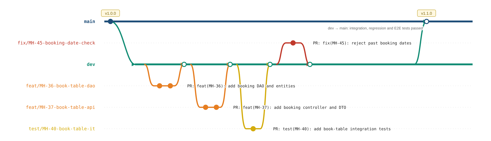

# Working agreement

## Branches
We use two long-lived branches. Both are protected: no direct pushes, every change goes through a PR with at least one approval and green CI.

| Branch | Purpose |
|---|---|
| `dev` | Integration branch. Code is written on task branches and reaches `dev` only through a reviewed PR with green CI. Default branch of the repo. |
| `main` | Only tested code, usable by the Product Owner. Shown at the demo and released. |

### Merge strategy

| PR | Merge method | Why |
|---|---|---|
| task branch → `dev` | **Squash and merge** | One commit per task on `dev` |
| `dev` → `main` | **Merge commit** | Keeps the shared history between long-lived branches |

The squash commit message is the PR title, so the PR title must follow Conventional Commits.

### Sprint flow
1. **Develop**: each task branch is created from `dev` and merged into `dev` through a PR.
2. **Release**: when all the stories selected for the demo are Done, run the full test suite on `dev`, manually test the selected stories, and build and run the Docker image on at least two different PCs. Then open a PR `dev` → `main` and tag the release (e.g. `v1.0.0`).

**Timing**: the release must be merged into `main` before Friday 8:30 of the demo day; after that, no commits and no updates on YouTrack.

Merged branches are deleted.

## Definition of Done
A story is **Done** when:
- [ ] all its tasks are merged into `dev` through reviewed PRs with green CI (code reviewed, code pushed on GitHub)
- [ ] every layer has unit tests
- [ ] the DAO and Route integration tests pass in `dev`
- [ ] the story's E2E tests exist, cover every acceptance criterion and pass in `dev`

A bug found in `dev` reopens the story until its fix is merged into `dev`.

## Branch naming
Each task branch corresponds to one YouTrack task and is named `<type>/MH-<id>-<short-description>`:
- `<type>`: same types as Conventional Commits (see below)
- `MH-<id>`: the ID of the YouTrack task, so the branch can be traced back to it
- `<short-description>`: a few words, lowercase, kebab-case, no personal names, no `/`

Examples:

    feat/MH-33-book-table-db-update
    feat/MH-36-book-table-dao
    feat/MH-37-book-table-controller
    feat/MH-38-book-table-route
    feat/MH-31-book-table-ui
    test/MH-39-book-table-dao-integration
    test/MH-40-book-table-route-integration
    test/MH-41-book-table-e2e
    fix/MH-50-booking-capacity-off-by-one

## Commits
We follow [Conventional Commits](https://www.conventionalcommits.org/en/v1.0.0/).

    <type>(<scope>): <description>

- Types: `feat`, `fix`, `docs`, `test`, `refactor`, `build`, `ci`, `chore`
- Scope: the part of the project involved, e.g. `backend`, `frontend`, `db`, `docs`
- Imperative, lowercase, no final period
- Commits on task branches are squashed into the PR title when merged, so the commits in `dev` use the YouTrack task ID as scope (see [Pull requests](#pull-requests)).

Examples:

    feat(backend): add booking DAO
    test(backend): add unit tests for booking controller
    fix(frontend): show error when no table is available
    docs(api): describe book-a-table endpoint

## Pull requests
- Title in Conventional Commits format, with the YouTrack task ID as scope: `feat(MH-37): add booking controller`.
- The description follows the PR template of the target branch, in `.github/PULL_REQUEST_TEMPLATE/`:
  - task branch → `dev`: `to-dev.md`
  - `dev` → `main`: `to-main.md`
- At least one approval from someone who is not the author, and CI green, before merging.
- One PR per task.
- The person merging checks that the merge method matches the table in "Merge strategy".

## Documentation
- Docs live in the repo as Markdown and are reviewed like code.
- `api.md`, `database.md` and `architecture.md` are part of the contract: they must always match the code in `dev`.